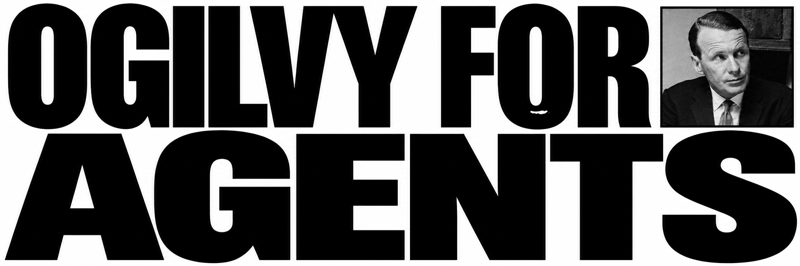

# Ogilvy for Agents



Twenty-three focused skills for researching, creating and reviewing marketing communication. The toolkit helps with positioning, copy, websites, proposals, acquisition and experiments while separating evidence from hypotheses.

An independent project inspired by selected ideas from David Ogilvy's *Ogilvy on Advertising*. It is not an official Ogilvy product or endorsed by Ogilvy. Skills are written in English and respond in the user's language.

## Why this project exists

Ogilvy for Agents grew out of studying *Ogilvy on Advertising* and asking how its ideas could help with actual communication work today. The first version turned selected notes into focused workflows for Veltas and other businesses. The toolkit later expanded to 23 skills and selected material from all 20 chapters.

The aim is practical judgment: understand the offer, ask what the audience needs, develop useful work and distinguish evidence from assumptions. The book is a starting point, not a substitute for current research or proof about a particular business.

## The skills

| Skill | What it helps you do |
| --- | --- |
| `ogilvy-advisor` | Scope a broad communication decision and select the most useful workflow. |
| `ogilvy-research-brief` | Organize what is known about the offer, audience and competing messages. |
| `ogilvy-positioning` | Define a credible offer, audience and central promise. |
| `ogilvy-brand-coherence` | Review whether messages, pricing and experience create a consistent brand image. |
| `ogilvy-creative-concepts` | Develop and compare creative campaign ideas linked to the product. |
| `ogilvy-claim-evidence` | Check commercial claims against the evidence actually available. |
| `ogilvy-copy-workshop` | Write or refine headlines, ads and other focused commercial copy. |
| `ogilvy-website-audit` | Review how a website communicates its offer and supports the next action. |
| `ogilvy-content-planning` | Plan useful content around audience needs and a clear business purpose. |
| `ogilvy-visual-direction` | Brief or review imagery, composition and legibility. |
| `ogilvy-demo-script` | Design a clear demonstration of a problem, solution, benefit and limits. |
| `ogilvy-commercial-proposal` | Build or review a client proposal with clear value and scope. |
| `ogilvy-client-communication` | Prepare clear, candid messages and conversations with clients. |
| `ogilvy-client-fit` | Assess whether to accept, renegotiate or decline a potential engagement. |
| `ogilvy-acquisition-plan` | Plan a bounded path from communication to inquiry and sales conversation. |
| `ogilvy-inquiry-analysis` | Compare inquiry sources by intent, follow-up and opportunity quality. |
| `ogilvy-buyer-messaging` | Adapt the same offer to the people who use, evaluate or approve a purchase. |
| `ogilvy-experiment-plan` | Design a limited test and define what would count as learning. |
| `ogilvy-knowledge-review` | Capture project or campaign lessons with their evidence and limits. |
| `ogilvy-conversion-diagnosis` | Identify plausible commercial bottlenecks and decide what to investigate. |
| `ogilvy-direct-response` | Create or review a direct-response message with a measurable next action. |
| `ogilvy-portfolio-focus` | Compare where to allocate attention across offers and campaigns. |
| `ogilvy-pricing-promotion` | Compare pricing and promotional options and their tradeoffs. |

## Install the skills

### Native marketplace

For Codex, run in a terminal:

```sh
codex plugin marketplace add juansuero/ogilvy-for-agents
codex plugin add ogilvy-practice-lab@ogilvy-for-agents
```

For Claude Code, run in a Claude Code session:

```text
/plugin marketplace add juansuero/ogilvy-for-agents
/plugin install ogilvy-practice-lab@ogilvy-for-agents
```

The installation identifier retains `ogilvy-practice-lab` for compatibility with the existing plugin. These marketplace paths are being validated; confirm the plugin and skills appear in a fresh session before relying on them. If the repository is private, the agent needs access.

### Ask your agent

**The easy way:** open your agent in the project where you want the skills, and paste:

```text
Install Ogilvy for Agents from https://github.com/juansuero/ogilvy-for-agents.
Read INSTALL.md in that repository and follow its instructions for this agent.
Use project-local scope and do not overwrite existing skills.
```

The agent will need access to the repository and permission to write in your project. If it cannot identify its environment or encounters an existing skill, it should ask rather than guess or overwrite. Installation is not yet verified end to end on each agent.

### Manual installation

Clone this repository, or extract a release ZIP into a folder named `ogilvy-for-agents`, and copy the **complete** `skills/ogilvy-*` directories, including their references, into your project's skill directory. Check for existing skills with the same names before copying: the commands below may overwrite files. If the repository is private, authenticate with an account that has access.

```sh
git clone https://github.com/juansuero/ogilvy-for-agents.git
# Replace /path/to/project with the project where the skills should be available.
mkdir -p /path/to/project/.agents/skills
cp -R ogilvy-for-agents/skills/ogilvy-* /path/to/project/.agents/skills/
```

This project-level `.agents/skills/` location is documented for [Codex](https://github.com/openai/codex/blob/main/codex-rs/app-server/tests/suite/v2/skills_list.rs), [OpenCode](https://opencode.ai/docs/skills/), and [Cursor](https://cursor.com/docs/skills). Use one installation per project. Restart or refresh your agent session if necessary.

For [Claude Code](https://code.claude.com/docs/en/skills), copy the directories into `.claude/skills/` instead:

```sh
mkdir -p /path/to/project/.claude/skills
cp -R ogilvy-for-agents/skills/ogilvy-* /path/to/project/.claude/skills/
```

On Windows PowerShell, the equivalent for Codex, OpenCode or Cursor is:

```powershell
$projectPath = 'C:/path/to/project'
New-Item -ItemType Directory -Force -Path "$projectPath/.agents/skills" | Out-Null
Copy-Item -Recurse 'ogilvy-for-agents/skills/ogilvy-*' "$projectPath/.agents/skills/"
```

For Claude Code, replace `.agents/skills` with `.claude/skills`. Do not install duplicate copies in multiple discovery paths for the same agent. Other agents supporting the Agent Skills format may work if they can discover each `SKILL.md` and its local references; consult their documentation.

These are manual **skill installations**, not a claim that this package is a native plugin for every agent. The documented locations were checked against official documentation; installation, discovery and behavioral results have not yet been verified in each host.

## Try it

- “Review only this headline. Preserve the facts and do not invent results: [text].”
- “Review this proposal and identify claims that need evidence: [proposal].”
- “We get many visits and few inquiries. Help me form hypotheses from these data: [data].”

Use `ogilvy-advisor` for a broad question or select a specialist under `skills/` for a focused task. Each skill includes its own references and optional template.

## Scope and status

The references cover selected sections of all 20 chapters, not the complete book. Historical studies and results are not independently verified. A book principle does not establish a client's facts or predict campaign performance. A commercial website review is not an SEO, security, accessibility or performance certification. The plugin supplies no server, automatic data access or Alchemy integration.

Version 0.2.2 is a beta. The 15 entries in `evals/regression-v0.2.jsonl` are prepared cases, not passing test results. Automatic routing and live installation remain unverified. The original 0.2.0 snapshot was exported from the private ChatGPT plugin; repository edits do not automatically synchronize with that plugin. The repository snapshot uses Juan Suero as author and chapter-and-section locators; the private ChatGPT release retains its existing Veltas author metadata and more specific locators. The internal package identifier remains `ogilvy-practice-lab` for continuity.

## Contents

- `skills/`: instructions, source summaries and templates.
- `evals/`: proposed regression cases.
- `plugin.json` and `.codex-plugin/`: plugin manifests.
- `assets/`: icon and repository banner.

## Authorship and license

Created by Juan Suero, founder of Veltas. Original contributions are available under the [MIT License](LICENSE). See [NOTICE](NOTICE.md) for attribution and third-party rights.
